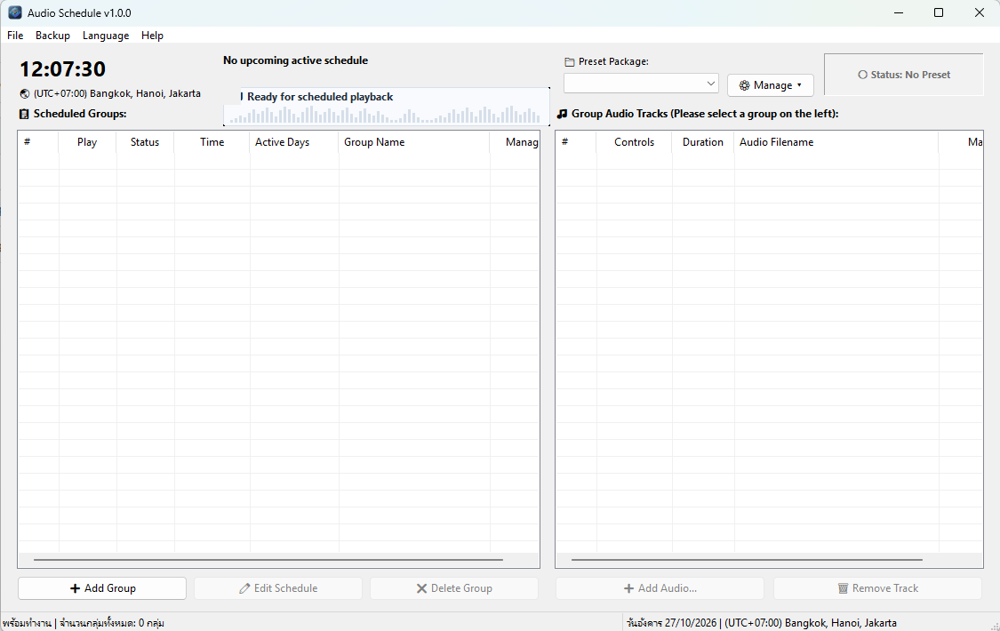

# Audio Schedule (ระบบตั้งเวลาและเล่นไฟล์เสียงอัตโนมัติ)

โปรแกรม Desktop GUI บน Windows พัฒนาด้วยภาษา **Modern C++ (C++17)** และ **Native Win32 API / Windows Common Controls** สำหรับตั้งเวลาเล่นไฟล์เสียง (.mp3, .wav, .wma, .m4a) อัตโนมัติตามกำหนดการ พร้อมระบบจัดการชุดข้อมูล (Presets), ระบบทำงานเบื้องหลังบนถาดระบบ (System Tray), การป้องกันการเปิดโปรแกรมซ้ำ (Single Instance), และตัวติดตั้งแบบมาตรฐาน Windows ที่รองรับการแก้ไข/ติดตั้งใหม่ (Maintenance & Modify)

---

---

## ฟังก์ชันการทำงานหลัก (Key Features)

### 1. หน้าจอหลักแบบสองฝั่ง (Split-View Layout)
- **แถบส่วนบน (Top Header Bar)**:
  - **นาฬิกา Real-time**: แสดงเวลาปัจจุบันของเครื่องระดับวินาที
  - **ป้าย Timezone**: ระบุเขตเวลาของระบบ เช่น `🌏 (UTC+07:00) Bangkok, Hanoi, Jakarta`
  - **แถบนับเวลาถอยหลัง (Countdown Timer)**: แสดงกลุ่มเสียงถัดไปที่จะเล่น พร้อมเวลานับถอยหลังแบบเรียลไทม์ (ชั่วโมง : นาที : วินาที)
  - **กล่องเลือกชุด Preset**: เลือกสลับชุดการทำงานได้ทันที
  - **ปุ่มดรอปดาวน์จัดการ Preset (`⚙️ จัดการ ▾`)**: รวมศูนย์การจัดการสร้างชุดใหม่, เปลี่ยนชื่อชุด, และลบชุดปัจจุบัน
  - **ป้ายสถานะการบันทึก**: แสดงผลชัดเจนระหว่าง `🟢 สถานะ: บันทึกแล้ว` และ `⚠️ สถานะ: ยังไม่ได้บันทึก`
- **ฝั่งซ้าย (Left Panel) - รายการกลุ่มเวลา (Schedule Groups)**:
  - ตารางแสดงกลุ่มเวลา พร้อมปุ่มทดสอบเล่นทันที (`▶️ เล่น` / `🔊 เล่นอยู่`)
  - สวิตช์สถานะเปิด/ปิด (`🟢 เปิด` / `🔴 ปิด`) สลับการทำงานได้ด้วยคลิกเดียว
  - ข้อมูลเวลาเริ่ม, วันที่ทำงานในสัปดาห์, ชื่อกลุ่ม, และจำนวนไฟล์เสียงในกลุ่ม
  - ปุ่มคำสั่งด้านล่าง: เพิ่มกลุ่มใหม่, แก้ไขกลุ่ม, ลบกลุ่ม
- **ฝั่งขวา (Right Panel) - รายการไฟล์เสียงในกลุ่ม (Group Playlist)**:
  - ควบคุมการเล่นระดับแทร็ก: เล่น (`▶️`), พักชั่วคราว (`⏸️`), เล่นต่อ, และหยุด (`⏹️`)
  - คำนวณความยาวไฟล์เสียงอัตโนมัติ (เช่น `03:45`) พร้อมระบบแคชความเร็วสูง
  - แสดงแหล่งที่มาของไฟล์อย่างโปร่งใส: `📁 ใน Preset` หรือ `🔗 ลิงก์ภายนอก`
  - ปรับลำดับการเล่นได้อิสระด้วยปุ่มเลื่อนขึ้น/ลง หรือลากวาง (Drag & Drop)
  - หน้าต่างยืนยันความปลอดภัยก่อนลบแทร็กเสียง

### 2. ป้องกันการเปิดซ้ำและคืนค่าหน้าต่างอัตโนมัติ (Single Instance Enforcement)
- ควบคุมการทำงานให้เปิดได้เพียงหน้าต่างเดียวด้วย Win32 Named Mutex
- หากผู้ใช้พยายามเปิดโปรแกรมซ้ำ ระบบจะตรวจจับและส่งข้อความไปปลุกหน้าต่างโปรแกรมเดิมที่ทำงานอยู่ขึ้นมาแสดงที่หน้าจอทันที (ไม่ว่าจะถูกย่ออยู่บน Taskbar หรือซ่อนอยู่ใน System Tray) ป้องกันปัญหาตารางเวลาหรือการเล่นเสียงทับซ้อนกัน

### 3. การทำงานเบื้องหลังบนถาดระบบ (System Tray & Background Running)
- **การกดย่อหน้าต่าง (`_`)**: หน้าต่างโปรแกรมจะถูกซ่อนและย่อลงไปทำงานเงียบๆ ใน System Tray (Notification Area มุมขวาล่างใกล้นาฬิกา) โดยไม่เกะกะแถบงาน (Taskbar)
- **ระบบทำงานต่อเนื่อง**: ตรวจสอบเวลาและสั่งเล่นเสียงอย่างแม่นยำ พร้อมแสดงบอลลูนแจ้งเตือน (Balloon Notification) เมื่องานเริ่มเล่น
- **การกู้คืนหน้าต่าง (Restore)**: คลิกซ้ายหรือดับเบิลคลิกที่ไอคอนถาดระบบเพื่อเปิดหน้าต่างกลับขึ้นมา
- **เมนูคลิกขวา (Context Menu)**: คำสั่งเปิดหน้าต่างหลัก, สั่งหยุดเสียงฉุกเฉินทันที (`⏹️`), และออกจากโปรแกรม
- **การกดปุ่มปิด (`X`)**: เป็นการปิดและออกจากโปรแกรมอย่างสมบูรณ์ตามปกติ

### 4. ระบบจัดการชุด Preset แบบรวมศูนย์ (`⚙️ จัดการ ▾`)
- **สร้างชุดใหม่ (New...)**: เลือกสร้างชุดว่างเปล่า หรือคัดลอกตารางเวลาจากชุดปัจจุบันมาเป็นต้นแบบ
- **เปลี่ยนชื่อชุด (Rename...)**: เปลี่ยนชื่อชุด Preset ได้ทันทีโดยไม่กระทบต่อไฟล์ข้อมูลภายใน
- **ลบชุดการเล่น (Delete...)**: ตรวจสอบไฟล์ในชุดก่อนลบอย่างปลอดภัย ไฟล์เสียงที่อยู่ในโฟลเดอร์ Preset จะถูกลบตามชุด แต่ไฟล์ภายนอกที่ลิงก์ไว้จะไม่ถูกแตะต้อง
- **ระบบพกพา (Audio Bundling)**: โปรแกรมจะคัดลอกไฟล์เสียงเข้ามาเก็บไว้ใน `presets/<ชื่อชุด>/audio/` ด้วยพาธสัมพัทธ์ (Relative Path) ทำให้สามารถคัดลอกทั้งโฟลเดอร์ใส่ Flash Drive ไปเปิดใช้งานที่คอมพิวเตอร์เครื่องอื่นได้ทันทีโดยไฟล์ไม่สูญหาย

### 5. รองรับการแก้ไขและติดตั้งใหม่ผ่าน Windows (Maintenance & Modify Mode)
- ลงทะเบียนในระบบจัดการแอปของ Windows (Installed apps / Apps & features / Control Panel) อย่างสมบูรณ์ ภายใต้ชื่อผู้เผยแพร่ **Softlunar Foundation**
- เปิดใช้งานปุ่ม **Modify (แก้ไข)** ใน Windows Settings: เมื่อกดจะเปิด Setup Wizard ในโหมด Maintenance ซึ่งมี 3 ตัวเลือก:
  1. **แก้ไข (Modify)**: อัปเดตไฟล์โปรแกรม ซ่อมแซมระบบ หรือตั้งค่าทางลัดใหม่ โดยข้อมูลเสียงและตารางเวลายังคงอยู่ครบถ้วน
  2. **ติดตั้งใหม่ทั้งหมด (Clean Install)**: ลบไฟล์โปรแกรม ข้อมูลตารางเวลา และ Presets เดิมทั้งหมดออกเสมือนถอนการติดตั้งแล้วเริ่มติดตั้งใหม่ตั้งแต่ต้น เหมาะสำหรับการเริ่มระบบใหม่
  3. **ถอนการติดตั้ง (Uninstall)**: ถอนโปรแกรม ทางลัด และข้อมูลใน Registry ออกจากเครื่องทั้งหมด

### 6. ความลื่นไหล ปราศจากการกะพริบ (100% Flicker-Free & Native Standalone)
- พัฒนาด้วย Native Win32 API 100% ไม่มี External Dependencies หรือ Runtime เสริม
- ใช้เทคนิค Subclassing Header Controls และ Double Buffering กำจัดการกะพริบของข้อความและหัวตารางอย่างสิ้นเชิง
- รองรับทั้งระบบปฏิบัติการ **32-bit (x86)** และ **64-bit (x64)** ใช้งานได้ตั้งแต่ **Windows XP, Vista, 7, 8, 8.1, 10 จนถึง Windows 11**

---

## ตารางคีย์ลัด (Keyboard Shortcuts)

| คีย์ลัด | คำสั่งและการทำงาน |
| :--- | :--- |
| **`Ctrl + S`** | บันทึกชุดการเล่นปัจจุบันทันที (Quick Save) |
| **`Ctrl + N`** | สร้างชุดการเล่นใหม่ (Create New Preset) |
| **`Delete`** | ลบกลุ่มเวลาที่เลือก (ฝั่งซ้าย) หรือลบไฟล์เสียงที่เลือก (ฝั่งขวา) พร้อมกล่องยืนยัน |
| **`Esc`** | ปิดหน้าต่าง Popup / Dialog ปัจจุบัน |
| **`F1`** | เปิดหน้าต่างคู่มือการใช้งานโปรแกรมฉบับสมบูรณ์ (User Manual) |

---

## การติดตั้งคอมไพเลอร์ MinGW / LLVM-MinGW (Compiler Prerequisites & Setup Guide)

โปรเจกต์ **Audio Schedule** พัฒนาด้วย **Modern C++ (C++17)** และเชื่อมโยงไลบรารี Win32 API แบบ Zero-Dependencies (`-static`) สามารถคอมไพล์ได้ทั้งแบบ 64-bit (`x86_64`) และ 32-bit (`x86`)

ชุดคอมไพเลอร์ที่ **แนะนำเป็นพิเศษสำหรับโปรเจกต์นี้** คือ **[LLVM-MinGW โดย Martin Storsjo](https://github.com/mstorsjo/llvm-mingw)**

### ทำไมจึงแนะนำ LLVM-MinGW?
1. **ครบจบในแพ็กเกจเดียว (Dual Architecture In One)**: ภายในโฟลเดอร์เดียวมีทั้งคอมไพเลอร์ 64-bit (`x86_64-w64-mingw32-g++`), 32-bit (`i686-w64-mingw32-g++`), และ Resource Compiler (`windres`) ครบถ้วน ทำให้สร้างไฟล์ติดตั้งได้ทั้ง 2 สถาปัตยกรรมโดยไม่ต้องติดตั้ง MinGW 32-bit เพิ่มเติม
2. **เป็นแบบพกพา ไม่ต้องติดตั้ง (Portable Standalone)**: เพียงแตกไฟล์ ZIP ก็พร้อมใช้งานทันที ไม่ต้องรันโปรแกรมติดตั้ง ไม่แตะต้อง Registry และไม่ต้องเชื่อมต่ออินเทอร์เน็ตระหว่างคอมไพล์
3. **คอมไพเลอร์ Clang/LLVM ทันสมัย**: ใช้ Clang C++17/20 และ LLD Linker ประสิทธิภาพสูง คอมไพล์ได้รวดเร็วและไฟล์ไบนารีมีขนาดกะทัดรัด

---

### แหล่งดาวน์โหลด (Download Source)
- **คลังโครงการอย่างเป็นทางการ (GitHub)**: [https://github.com/mstorsjo/llvm-mingw](https://github.com/mstorsjo/llvm-mingw)
- **หน้าดาวน์โหลด Releases ล่าสุด**: [https://github.com/mstorsjo/llvm-mingw/releases](https://github.com/mstorsjo/llvm-mingw/releases)

#### คำแนะนำการเลือกไฟล์ดาวน์โหลด:
| ไฟล์ที่แนะนำ | เหมาะสำหรับ | รายละเอียด |
| :--- | :--- | :--- |
| **`llvm-mingw-<version>-ucrt-x86_64.zip`** *(แนะนำที่สุด)* | Windows 10 / Windows 11 (64-bit) | ใช้รันไทม์ UCRT มาตรฐานของ Windows สมัยใหม่ มีประสิทธิภาพสูงสุด |
| **`llvm-mingw-<version>-msvcrt-x86_64.zip`** | รองรับย้อนหลัง Windows XP / Vista / 7 / 8 / 10 / 11 | ใช้ MSVCRT ดั้งเดิม สามารถคอมไพล์โปรแกรมให้ทำงานบนระบบปฏิบัติการรุ่นเก่าได้ |

---

### ขั้นตอนการติดตั้งทีละสเต็ป (Step-by-Step Installation)

#### ขั้นตอนที่ 1: ดาวน์โหลดไฟล์ ZIP
1. เข้าไปที่หน้า Releases: [https://github.com/mstorsjo/llvm-mingw/releases](https://github.com/mstorsjo/llvm-mingw/releases)
2. เลื่อนลงมาที่หัวข้อ **Assets** ของเวอร์ชันล่าสุด
3. คลิกดาวน์โหลดไฟล์ เช่น `llvm-mingw-xxxx-ucrt-x86_64.zip`

#### ขั้นตอนที่ 2: แตกไฟล์ ZIP (Extract)
1. นำไฟล์ ZIP ที่ดาวน์โหลดมา แตกไฟล์ (Extract All) ไปยังตำแหน่งที่ต้องการ เช่น:
   - `C:\llvm-mingw`
   - หรือไว้ในโฟลเดอร์โปรเจกต์: `toolchain\llvm-mingw` (โฟลเดอร์ `toolchain/` ถูกละเว้นใน `.gitignore`)
2. ตรวจสอบให้แน่ใจว่ามีโฟลเดอร์ `bin` ภายใน (เช่น `C:\llvm-mingw\bin`) ซึ่งจะมีไฟล์คอมไพเลอร์ต่างๆ อยู่ครบถ้วน

#### ขั้นตอนที่ 3: กำหนดค่าเพื่อใช้งาน (เลือกวิธีใดวิธีหนึ่ง)

##### วิธี A: ให้ระบบ `build.cmd` ตรวจจับอัตโนมัติ (สะดวกที่สุด - แนะนำ)
- หากแตกไฟล์ไว้ที่ `C:\llvm-mingw`, `D:\llvm-mingw` หรือในโฟลเดอร์ `toolchain\llvm-mingw` สคริปต์ `build.cmd` จะตรวจพบและเชื่อมโยงคอมไพเลอร์ทั้ง 64-bit และ 32-bit ให้อัตโนมัติทันที
- หรือสร้างไฟล์ `build.local.bat` ในโฟลเดอร์โปรเจกต์ แล้วระบุพาธ:
  ```cmd
  set "LLVM_MINGW_BIN=C:\llvm-mingw\bin"
  ```
  *(หรือหากเปิดรัน `build.cmd` ครั้งแรกแล้วยังไม่พบคอมไพเลอร์ ระบบจะมีข้อความถามพาธ ให้คัดลอกพาธ เช่น `C:\llvm-mingw\bin` มาวาง แล้วระบบจะบันทึกลง `build.local.bat` ให้ถาวร)*

##### วิธี B: เพิ่มโฟลเดอร์ bin เข้า Windows System PATH (สามารถเรียกใช้จาก Terminal ใดก็ได้)
1. กดปุ่ม `Win + R` พิมพ์ `sysdm.cpl` แล้วกด `Enter`
2. เลือกแท็บ **Advanced (ขั้นสูง)** -> คลิกปุ่ม **Environment Variables... (ตัวแปรสภาพแวดล้อม)**
3. ในกล่อง **User variables** (หรือ **System variables**) ดับเบิลคลิกที่รายการ `Path`
4. คลิกปุ่ม **New (สร้างใหม่)** แล้วพิมพ์พาธโฟลเดอร์ `bin` เช่น:
   ```text
   C:\llvm-mingw\bin
   ```
5. คลิก **OK** ทุกหน้าต่างเพื่อบันทึกการตั้งค่า

##### วิธี C: ติดตั้งผ่าน Scoop (สำหรับผู้ใช้ Scoop Package Manager)
```powershell
scoop bucket add main
scoop install llvm-mingw
```

---

### การตรวจสอบความพร้อมของคอมไพเลอร์ (Verification)
เปิด Command Prompt หรือ PowerShell แล้วทดสอบรันคำสั่งต่อไปนี้:

```powershell
# 1. ตรวจสอบคอมไพเลอร์ 64-bit
x86_64-w64-mingw32-g++ --version

# 2. ตรวจสอบคอมไพเลอร์ 32-bit
i686-w64-mingw32-g++ --version

# 3. ตรวจสอบ Resource Compiler
x86_64-w64-mingw32-windres --version
```
หากระบบแสดงหมายเลขเวอร์ชันของ LLVM/Clang แสดงว่าพร้อมคอมไพล์โปรเจกต์ได้ทันที

---

## วิธีการคอมไพล์และสร้างชุดติดตั้ง (Build System)

โปรแกรมมาพร้อมระบบคอมไพล์และสร้างชุดติดตั้งอัตโนมัติผ่านไฟล์คำสั่ง `build.cmd` โดยมีเมนู Interactive ที่รองรับการเลื่อนลูกศร `[↑]` `[↓]` แล้วกด `[Enter]` เพื่อสั่งงานได้ทันที:

```text
======================================================================
            Audio Schedule - ระบบคอมไพล์และสร้างชุดติดตั้ง
                     Version 1.0.0
======================================================================
  ใช้ปุ่มลูกศร [↑] [↓] เพื่อเลื่อน และกด [Enter] เพื่อเลือก (ESC เพื่อยกเลิก)

   ►  สร้างตัวติดตั้ง (Build Installer - Setup .exe)
      สร้างแบบพกพา (Build Portable - ZIP)
      สร้างทั้ง 2 แบบ (Build Both - Portable + Installer)
      ล้างไฟล์ชั่วคราวและผลลัพธ์ (Clean Build & Dist)
      ออกจากโปรแกรม (Exit)
```

### รูปแบบผลลัพธ์ที่สร้างได้ (Distribution Formats):
1. **ตัวติดตั้งมาตรฐาน (Setup Installer - .exe)**:
   - ไฟล์: `dist/AudioSchedule_Setup_v1.0.0_x64.exe` และ `dist/AudioSchedule_Setup_v1.0.0_x86.exe`
   - มีหน้าต่าง Setup Wizard เลือกติดตั้งแบบ User Mode (ไม่ต้องใช้สิทธิ์ Admin / ไม่ติด UAC) หรือ Admin Mode (Program Files)
   - สร้างทางลัดบน Desktop, Start Menu และลงทะเบียนในระบบ Windows Apps & features พร้อมรองรับปุ่ม **Modify**
   - รองรับการติดตั้งแบบเงียบอัตโนมัติผ่านพารามิเตอร์: `AudioSchedule_Setup_v1.0.0_x64.exe /S`
2. **แบบพกพา (Portable - ZIP Only)**:
   - ไฟล์: `dist/AudioSchedule_v1.0.0_x64_Portable.zip` และ `dist/AudioSchedule_v1.0.0_x86_Portable.zip`
   - สร้างเฉพาะไฟล์ `.zip` พร้อมใช้งาน แตกไฟล์แล้วเปิดรันได้ทันทีบน Flash Drive โดยไม่แตะต้อง Registry

### การตรวจจับคอมไพเลอร์อัตโนมัติ (Toolchain Auto-Detection):
ระบบ build.cmd ออกแบบให้สามารถทำงานได้บนทุกเครื่องทันทีโดยไม่ต้องแก้ไขสคริปต์ มีระบบค้นหาและเชื่อมโยง MinGW / LLVM-MinGW อัตโนมัติ:
1. **ค้นหาอัตโนมัติจากตำแหน่งมาตรฐานบน Windows**:
   - ค้นหาจาก System PATH (`x86_64-w64-mingw32-g++`, `i686-w64-mingw32-g++`, `g++`)
   - **LLVM-MinGW (แนะนำ)**: `C:\llvm-mingw\bin`, `D:\llvm-mingw\bin`, `%USERPROFILE%\llvm-mingw\bin`, `%~dp0toolchain\llvm-mingw\bin`
   - **MSYS2**: `C:\msys64\mingw64\bin`, `ucrt64\bin`, `clang64\bin`, `mingw32\bin` (รวมถึงไดรฟ์ `D:\`)
   - **WinLibs / Standalone MinGW**: `C:\winlibs\bin`, `C:\mingw64\bin`, `C:\mingw-w64\bin`, `C:\tools\mingw64\bin`
   - **Scoop**: `%USERPROFILE%\scoop\apps\llvm-mingw\current\bin`, `%USERPROFILE%\scoop\apps\mingw\current\bin`
2. **รองรับการกำหนดพาธเฉพาะเครื่อง (Custom / Portable Toolchain)**:
   - ผ่านตัวแปรสภาพแวดล้อม: `set LLVM_MINGW_BIN=C:\path\to\bin` หรือ `set MINGW64_BIN=C:\path\to\bin`
   - หรือสร้างไฟล์ `build.local.bat` ในโฟลเดอร์โปรเจกต์ (ถูกเพิกเฉยใน `.gitignore` จึงไม่ถูกดันขึ้น Git)
   - หากตรวจไม่พบคอมไพเลอร์ ระบบจะมีหน้าต่างถามและบันทึกพาธลงใน `build.local.bat` ให้อัตโนมัติในครั้งแรก

### การสั่งงานผ่าน Command Line:
```cmd
build.cmd installer 64     :: สร้างตัวติดตั้ง 64-bit
build.cmd installer 32     :: สร้างตัวติดตั้ง 32-bit
build.cmd portable 64      :: สร้างชุด Portable ZIP 64-bit
build.cmd portable 32      :: สร้างชุด Portable ZIP 32-bit
build.cmd both all         :: สร้างครบทุกรูปแบบทั้ง 64-bit และ 32-bit
build.cmd clean            :: ล้างไฟล์ชั่วคราวทั้งหมด
```

---

## โครงสร้างโปรเจกต์ (Project Structure)

```text
AudioSchedule/
├── src/
│   ├── installer/                  # ซอร์สโค้ดระบบติดตั้งและถอนการติดตั้ง
│   │   ├── Installer.cpp           # ตัวช่วยติดตั้ง (Setup Wizard) และโหมด Maintenance/Modify
│   │   ├── Uninstaller.cpp         # ตัวถอนการติดตั้งอัตโนมัติ (Uninstall.exe)
│   │   ├── installer.rc            # ทรัพยากรและไอคอนของตัวติดตั้ง
│   │   └── uninstaller.rc          # ทรัพยากรและไอคอนของตัวถอนการติดตั้ง
│   ├── AboutDialog.hpp             # กล่องแสดงข้อมูลโปรแกรม เวอร์ชัน ผู้พัฒนา และสัญญาอนุญาต
│   ├── AppSettings.hpp             # ระบบจัดการและบันทึกการตั้งค่าโปรแกรม
│   ├── AudioEngine.hpp             # กลไกควบคุมการเล่นไฟล์เสียงผ่าน Win32 MCI
│   ├── DeletePresetDialog.hpp      # หน้าต่างยืนยันการลบชุด Preset อย่างปลอดภัย
│   ├── GroupDialog.hpp             # หน้าต่างเพิ่ม/แก้ไขกลุ่มเวลาและเลือกวันในสัปดาห์
│   ├── ItemDialog.hpp              # โครงสร้างจัดการรายการเวลา
│   ├── Language.h                  # ระบบจัดการข้อความหลายภาษา (ไทย / อังกฤษ)
│   ├── MainWindow.hpp              # หน้าต่างหลัก GUI ตารางเวลา นาฬิกา ถาดระบบ และคีย์ลัด
│   ├── ManualDialog.hpp            # หน้าต่างแสดงคู่มือการใช้งานในโปรแกรม (F1)
│   ├── NewPresetDialog.hpp         # หน้าต่างสร้างชุด Preset ใหม่
│   ├── PresetManager.hpp           # กลไกจัดเก็บ/โหลดตารางเวลาและคัดลอกไฟล์เสียง (JSON)
│   ├── RenameAudioDialog.hpp       # หน้าต่างแก้ไขชื่อและลำดับไฟล์เสียง
│   ├── RenamePresetDialog.hpp      # หน้าต่างเปลี่ยนชื่อชุด Preset ปัจจุบัน
│   ├── SavePresetDialog.hpp        # หน้าต่างบันทึกชุด Preset
│   ├── ScheduleGroup.hpp           # โครงสร้างข้อมูลกลุ่มตารางเวลา
│   ├── ScheduleItem.hpp            # โครงสร้างข้อมูลแทร็กเสียงและสถานะ
│   ├── SettingsDialog.hpp          # หน้าต่างตั้งค่าระบบ
│   ├── Version.h                   # ศูนย์กลางกำหนดเลขเวอร์ชัน ข้อมูลผู้พัฒนา และลิขสิทธิ์
│   ├── app.manifest                # Windows Common Controls 6.0 & Per-Monitor DPI manifest
│   ├── app.rc                      # ทรัพยากรหลัก ไอคอน และข้อมูลไฟล์ของแอปพลิเคชัน
│   └── main.cpp                    # จุดเริ่มต้นโปรแกรม (wWinMain & Single Instance Mutex)
├── tools/
│   ├── menu.cpp                    # เครื่องมือสร้างเมนูกดเลือกด้วยลูกศรใน Command Prompt
│   └── packer.cpp                  # เครื่องมือรวมไฟล์ Payload สำหรับตัวติดตั้ง
├── LICENSE                         # สัญญาอนุญาต MIT License
├── MANUAL.md                       # คู่มือการใช้งานโปรแกรมฉบับเต็มสำหรับผู้ใช้
├── build.cmd                       # สคริปต์คอมไพล์และแพ็กเกจอัตโนมัติ
└── dist/                           # โฟลเดอร์เก็บผลลัพธ์ตัวติดตั้งและ Portable ZIP
```

---

## ข้อมูลลิขสิทธิ์และทีมพัฒนา (License & Team)

- **ผู้พัฒนา (Author)**: Mr.Weerapat Nusui (<weerapat.mailbox@gmail.com>)
- **ทีมงาน / องค์กร (Team / Publisher)**: Softlunar Foundation
- **เว็บไซต์ (Website)**: [softlunar.com](https://softlunar.com)
- **อีเมล (Email)**: [weerapat.mailbox@gmail.com](mailto:weerapat.mailbox@gmail.com)
- **สัญญาอนุญาต (License)**: เผยแพร่ภายใต้ [MIT License](LICENSE) ใช้งานและพัฒนาต่อยอดได้ฟรี
- **ลิขสิทธิ์ (Copyright)**: Copyright &copy; 2026 Mr.Weerapat Nusui &lt;weerapat.mailbox@gmail.com&gt; & Softlunar Foundation. All rights reserved.
